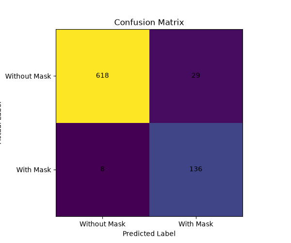
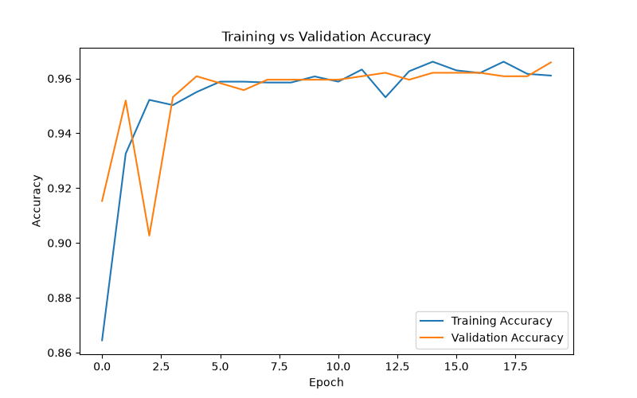
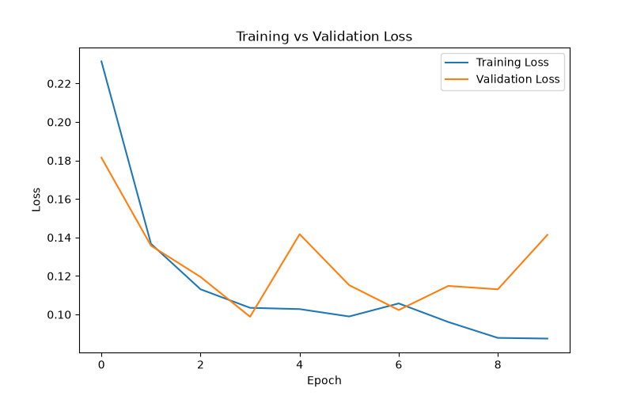

<<<<<<< HEAD
\# Face Mask Detection System


A deep learning-based Face Mask Detection System that uses a Convolutional Neural Network (CNN) and OpenCV to detect whether a person is wearing a face mask through a live webcam.


\## Features


\* Real-time face mask detection

\* Face detection using OpenCV

\* CNN-based image classification

\* Training and validation pipeline

\* Accuracy and loss visualization

\* Confusion matrix analysis

\* Precision, recall and F1-score evaluation

\* Live webcam detection


\## Technologies Used


\* Python

\* TensorFlow

\* Keras

\* OpenCV

\* NumPy

\* Scikit-learn

\* Matplotlib


\## Dataset


The dataset contains two classes:


\* With Mask

\* Without Mask


The dataset was prepared from annotated face images and divided into training and validation sets.


\### Dataset Distribution


| Class        |    Images |

| ------------ | --------: |

| With Mask    |     3,232 |

| Without Mask |       717 |

| \*\*Total\*\*    | \*\*3,949\*\* |


\## Model


The project uses a Convolutional Neural Network (CNN) for binary image classification.


The model contains:


\* Convolutional layers

\* Max Pooling layers

\* Flatten layer

\* Dense layer

\* Dropout layer

\* Binary classification output


\### Input Size


`128 × 128`


\## Training


The CNN model was trained for 10 epochs using the prepared dataset.


The training process includes:


1\. Dataset preparation

2\. Dataset splitting

3\. CNN model training

4\. Accuracy and loss visualization

5\. Model evaluation

6\. Real-time webcam detection


\## Model Performance


The model achieved approximately \*\*95% overall accuracy\*\* on the evaluation dataset containing 791 images.


\### Classification Report


| Class                | Precision | Recall | F1-Score |

| -------------------- | --------: | -----: | -------: |

| Without Mask         |      0.99 |   0.96 |     0.97 |

| With Mask            |      0.82 |   0.94 |     0.88 |

| \*\*Overall Accuracy\*\* |           |        | \*\*0.95\*\* |


\## Confusion Matrix


The confusion matrix shows the correct and incorrect predictions made by the model.


\* 618 without-mask images were correctly classified

\* 136 with-mask images were correctly classified

\* 29 without-mask images were incorrectly classified

\* 8 with-mask images were incorrectly classified


!\[Confusion Matrix](confusion\_matrix.png)


\## Training Results


\### Accuracy Graph


!\[Accuracy Graph](accuracy\_graph.png)


\### Loss Graph


!\[Loss Graph](loss\_graph.png)


\## Real-Time Detection


The trained CNN model is integrated with OpenCV to perform real-time face mask detection through a webcam.


The system detects faces from the camera feed and classifies them as:


\* With Mask

\* Without Mask


\## Project Structure


```text

Face-Mask-Detection-System/

│

├── training/

│   ├── prepare\_dataset.py

│   ├── split\_dataset.py

│   ├── model.py

│   └── evaluate\_model.py

│

├── detection/

│   └── detection.py

│

├── accuracy\_graph.png

├── loss\_graph.png

├── confusion\_matrix.png

├── requirements.txt

├── test.py

├── .gitignore

└── README.md

```


\## Installation


Clone the repository:


```bash

git clone https://github.com/adii-ctrl/Face-Mask-Detection-System.git

cd Face-Mask-Detection-System

```


Create and activate a virtual environment:


```bash

python -m venv venv

```


On Windows PowerShell:


```powershell

venv\\Scripts\\Activate.ps1

```


Install the required dependencies:


```bash

pip install -r requirements.txt

```


\## Running the Project


To evaluate the trained model:


```bash

python training/evaluate\_model.py

```


To start real-time webcam detection:


```bash

python detection/detection.py

```


Press `q` to close the webcam detection window.


\## Future Improvements


\* Improve detection accuracy for partially covered faces

\* Add data augmentation

\* Improve performance on different lighting conditions

\* Add support for multiple face detection

\* Develop a web-based interface

\* Deploy the model as a real-time application


\## Author


\*\*Aditya Mourya\*\*


GitHub: https://github.com/adii-ctrl


\## License


This project is created for educational and academic purposes.


=======
# Face Mask Detection System

A deep learning-based Face Mask Detection System that uses a Convolutional Neural Network (CNN) and OpenCV to detect whether a person is wearing a face mask through a live webcam.

## Features

* Real-time face mask detection
* Face detection using OpenCV
* CNN-based image classification
* Training and validation pipeline
* Accuracy and loss visualization
* Confusion matrix analysis
* Precision, recall and F1-score evaluation
* Live webcam detection

## Technologies Used

* Python
* TensorFlow
* Keras
* OpenCV
* NumPy
* Scikit-learn
* Matplotlib

## Dataset

The dataset contains two classes:

* With Mask
* Without Mask

The dataset was prepared from annotated face images and divided into training and validation sets.

### Dataset Distribution

| Class        |    Images |
| ------------ | --------: |
| With Mask    |     3,232 |
| Without Mask |       717 |
| **Total**    | **3,949** |

## Model

The project uses a Convolutional Neural Network (CNN) for binary image classification.

The model contains:

* Convolutional layers
* Max Pooling layers
* Flatten layer
* Dense layer
* Dropout layer
* Binary classification output

### Input Size

`128 × 128`

## Training

The CNN model was trained for 10 epochs using the prepared dataset.

The training process includes:

1. Dataset preparation
2. Dataset splitting
3. CNN model training
4. Accuracy and loss visualization
5. Model evaluation
6. Real-time webcam detection

## Model Performance

The model achieved approximately **95% overall accuracy** on the evaluation dataset containing 791 images.

### Classification Report

| Class                | Precision | Recall | F1-Score |
| -------------------- | --------: | -----: | -------: |
| Without Mask         |      0.99 |   0.96 |     0.97 |
| With Mask            |      0.82 |   0.94 |     0.88 |
| **Overall Accuracy** |           |        | **0.95** |

## Confusion Matrix

The confusion matrix shows the correct and incorrect predictions made by the model.

* 618 without-mask images were correctly classified
* 136 with-mask images were correctly classified
* 29 without-mask images were incorrectly classified
* 8 with-mask images were incorrectly classified



## Training Results

### Accuracy Graph



### Loss Graph



## Real-Time Detection

The trained CNN model is integrated with OpenCV to perform real-time face mask detection through a webcam.

The system detects faces from the camera feed and classifies them as:

* With Mask
* Without Mask

## Project Structure

```text
Face-Mask-Detection-System/
│
├── training/
│   ├── prepare_dataset.py
│   ├── split_dataset.py
│   ├── model.py
│   └── evaluate_model.py
│
├── detection/
│   └── detection.py
│
├── accuracy_graph.png
├── loss_graph.png
├── confusion_matrix.png
├── requirements.txt
├── test.py
├── .gitignore
└── README.md
```

## Installation

Clone the repository:

```bash
git clone https://github.com/adii-ctrl/Face-Mask-Detection-System.git
cd Face-Mask-Detection-System
```

Create and activate a virtual environment:

```bash
python -m venv venv
```

On Windows PowerShell:

```powershell
venv\Scripts\Activate.ps1
```

Install the required dependencies:

```bash
pip install -r requirements.txt
```

## Running the Project

To evaluate the trained model:

```bash
python training/evaluate_model.py
```

To start real-time webcam detection:

```bash
python detection/detection.py
```

Press `q` to close the webcam detection window.

## Future Improvements

* Improve detection accuracy for partially covered faces
* Add data augmentation
* Improve performance on different lighting conditions
* Add support for multiple face detection
* Develop a web-based interface
* Deploy the model as a real-time application

## Author

**Aditya Mourya**

GitHub: https://github.com/adii-ctrl

## License

This project is created for educational and academic purposes.
>>>>>>> 1b1ca01 (Improve face mask detection stability)
